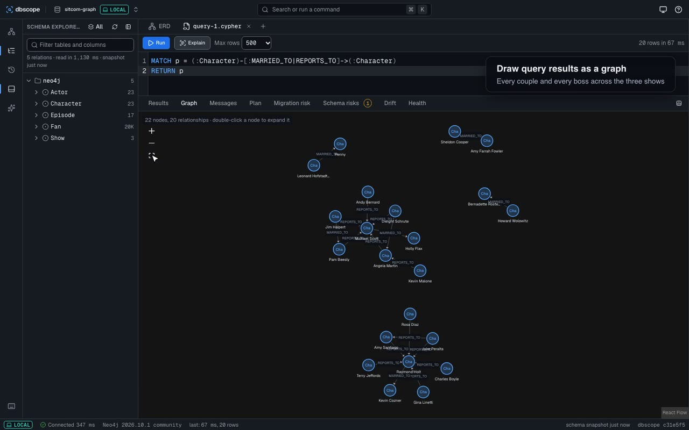
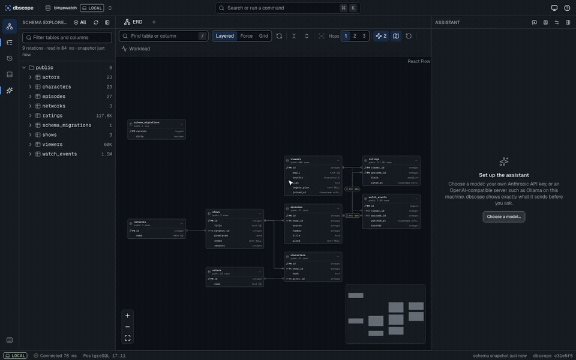
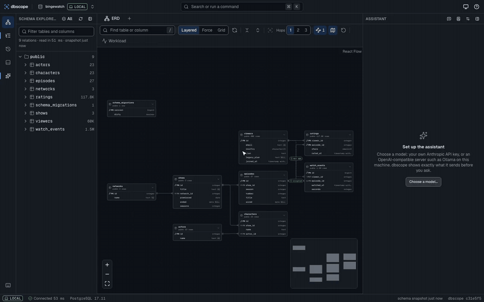
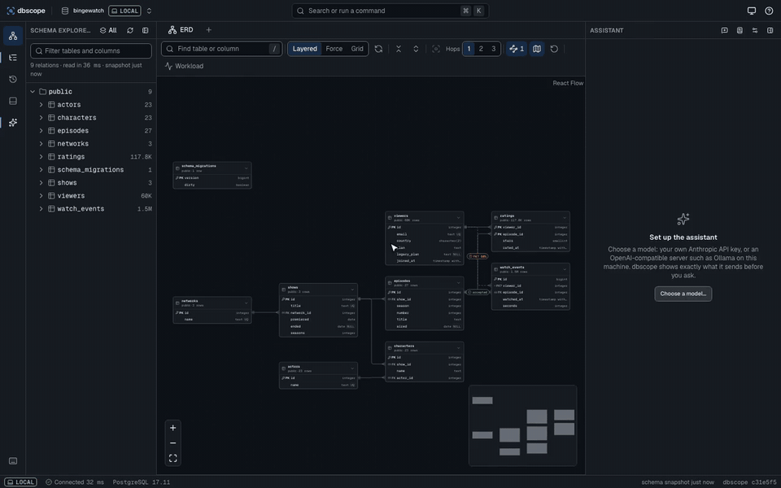
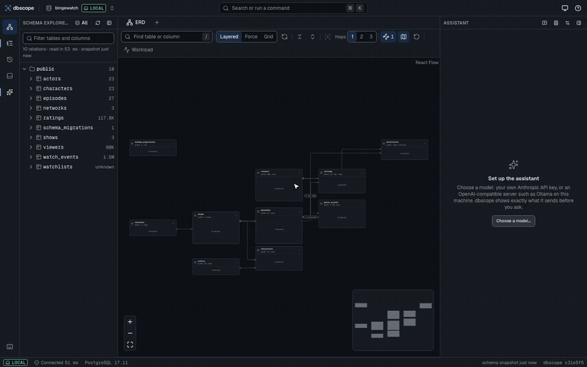
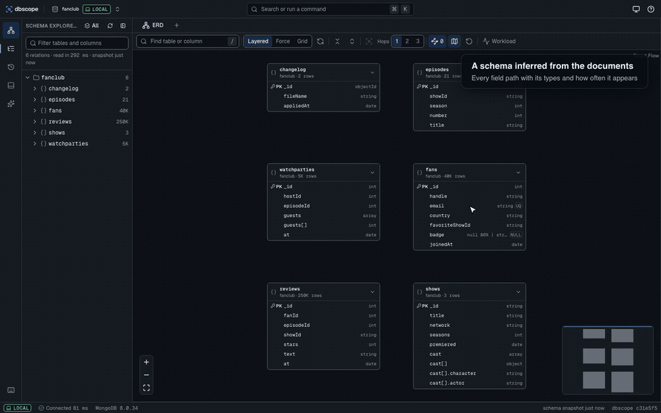
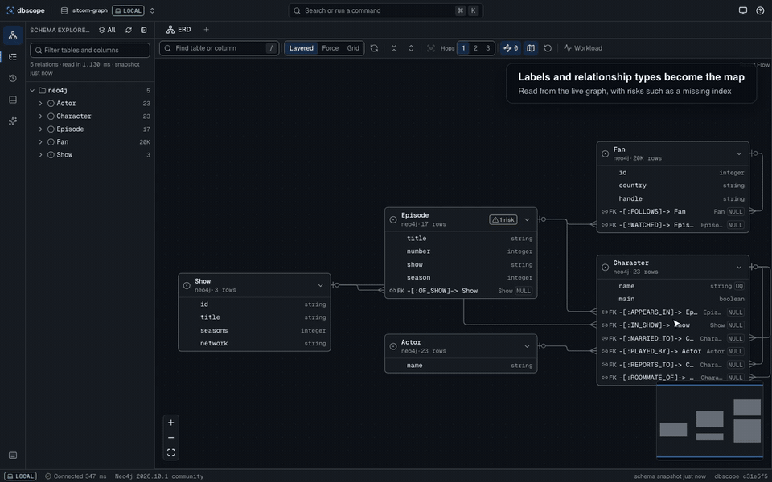
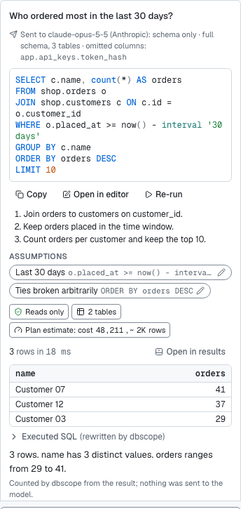

# dbscope

A local-first workbench for your databases. One binary on your machine connects
to PostgreSQL, MySQL, SQL Server, Oracle, SQLite, MongoDB, Neo4j, ClickHouse,
Elasticsearch, Cassandra, Redis and DynamoDB, and opens a web UI on `127.0.0.1`:

- **Schema map**: an interactive diagram of the live database, with the foreign
  keys nobody declared.
- **Safe queries**: read-only by construction, with the query plan drawn on the map.
- **Migration review**: the locks, rewrites and breaking changes a migration
  causes, who would block it right now, and a safer way to write it. The same
  check runs in CI.
- **Workload, health and drift**: which tables real traffic uses, what is wrong
  with the server, and what changed in the schema since last time.

Everything runs locally. There is no dbscope server, no telemetry and no account.

[](docs/media/dbscope-demo.mp4)

▶ **[Watch the 4-minute demo](docs/media/dbscope-demo.mp4)**: PostgreSQL, MongoDB
and Neo4j databases about *The Big Bang Theory*, *The Office* and *Brooklyn
Nine-Nine*. The show, episode and cast facts are real; viewers, watch history and
reviews are generated.

## Quick start

You need **Go 1.26+** (a newer toolchain downloads itself if needed) and **Node 22.12+**.

```bash
git clone https://github.com/ShreedharJoshi31/dbscope.git
cd dbscope
make build
./bin/dbscope ui
```

The browser opens on the onboarding page. Paste a connection URL such as
`postgres://reader@localhost:5432/app` or `mongodb://reader@localhost:27017/app`,
and dbscope fills in the form. No database at hand? Choose **Open sample schema**.

On Windows without `make`, run the build steps directly:

```powershell
npx -y pnpm@12.15.0 --dir web install --frozen-lockfile
npx -y pnpm@12.15.0 --dir web build
go build -o bin/dbscope.exe ./cmd/dbscope
```

`go install` alone is **not** enough: the UI is built by the web step and then
embedded, so a plain `go build` gives a binary that only serves its API.

## Features

### Schema map

Every table, column and key of the live database, laid out for you. Columns
named like a key but never declared as one (`watch_events.episode_id`) become
inferred foreign keys you accept or reject. Search any table or column, then
focus on it and its neighbours.



### Queries and plans

Queries run read-only: on a connection the database itself keeps read-only,
in a transaction that is always rolled back where the engine has transactions,
with a statement timeout and a cap on the rows read. On PostgreSQL each query
must also be exactly one `SELECT`, checked by PostgreSQL's own parser. The plan is shown step by step and drawn on
the schema map, with problems such as a sequential scan of 1.5M rows called out.
**Workload** shades each table by how much real traffic uses it. Details:
[docs/QUERY-SAFETY.md](docs/QUERY-SAFETY.md), [docs/WORKLOAD.md](docs/WORKLOAD.md).



### Migration review

Point a connection at its migrations folder and dbscope checks what is pending.
Nothing in the migration runs against your database, and no LLM is involved.

- **Only pending files**: applied ones are skipped using the migration tool's
  own history table (Flyway, golang-migrate, goose, dbmate, Rails, Prisma,
  migrate-mongo, neo4j-migrations, elasticsearch-evolution).
- **Every statement explained**: the lock it takes, whether it rewrites the
  table, how long it should run on this table's size, and a safer rewrite.
- **Who would block it right now**: open sessions holding locks the migration
  needs.
- **Code that still uses it**: lines in your app that read a column the
  migration drops or renames.
- **Rollback check**: whether the down migration really undoes the up one.
- **Re-check on save**: the review updates as you edit the file.



Rules and scoring: [docs/MIGRATIONS.md](docs/MIGRATIONS.md); per-engine rules:
[docs/ENGINES.md](docs/ENGINES.md).

### Health and schema drift

**Health** checks the server: long transactions, sessions idle in a transaction,
transaction ID age, replication lag, dead rows, invalid indexes, cache hits.
**Compare schema** shows what changed since an earlier read, or against another
connection. Details: [docs/HEALTH.md](docs/HEALTH.md).



### Beyond SQL

Each engine gets the modes that make sense for it, built on its own semantics.
MongoDB collections get a schema inferred from their documents, queries are
command documents with plans that flag collection scans, and migrate-mongo
scripts are reviewed like SQL migrations.



Neo4j labels and relationship types become the map, query results can be drawn
as a graph, and plans flag patterns that can walk the whole graph.



| Engine | Map | Query and plan | Migration review | Workload | Health |
|---|---|---|---|---|---|
| PostgreSQL | ✓ | ✓ | ✓ | ✓ | ✓ |
| MySQL, MariaDB | ✓ | ✓ | ✓ | ✓ | ✓ |
| SQL Server, Azure SQL | ✓ | ✓ | ✓ | ✓ | ✓ |
| Oracle | ✓ | ✓ | ✓ | ✓ | ✓ |
| SQLite | ✓ | ✓ | ✓ | | |
| MongoDB | ✓ | ✓ | ✓ | ✓ | ✓ |
| Neo4j | ✓ | ✓ (and graph view) | ✓ | ✓ | ✓ |
| ClickHouse | ✓ | ✓ | ✓ | ✓ | ✓ |
| Elasticsearch, OpenSearch | ✓ | ✓ | ✓ | ✓ | ✓ |
| Cassandra, ScyllaDB | ✓ | ✓ | ✓ | | ✓ |
| Redis, Valkey | keyspace report | | | | ✓ |
| DynamoDB | ✓ | ✓ | | | |

Connections can go through an SSH bastion, and PostgreSQL and MySQL on RDS or
Aurora can sign in with IAM. Details: [docs/ENGINES.md](docs/ENGINES.md).

## Connecting safely

dbscope only ever runs read-only work, but the safest setup is still a login
that can only read. For PostgreSQL:

```sql
CREATE ROLE dbscope_reader LOGIN PASSWORD '...';
GRANT CONNECT ON DATABASE app TO dbscope_reader;
GRANT USAGE ON SCHEMA public TO dbscope_reader;
GRANT SELECT ON ALL TABLES IN SCHEMA public TO dbscope_reader;
```

**Test connection** reports whether the login can write, whether the server is a
replica, and other warnings. Tag each connection as `local`, `staging` or
`prod-replica`; prod-replica connections show a permanent red banner, use a
shorter statement timeout and ask before expensive queries.

## What leaves your machine

| What | Where it goes | When |
|---|---|---|
| Database passwords | an encrypted file (`age`) whose key is in your OS keychain; never sent anywhere | always |
| Schema (table and column names, types, keys, comments) | the AI provider you configure | only when you ask the assistant a question |
| Result rows | the AI provider | only if you set the connection's summary mode to **rows**; on prod-replica you confirm first |
| Anything | Anthropic, OpenAI or any other service | never by default: no telemetry, no update checks |

Columns whose names look secret (`password`, `token`, `api_key`, …) are left
out of what the assistant sees. With the default summary mode, the short
summary under each answer is counted by dbscope itself and nothing about the
result is sent.

## The assistant (PostgreSQL)

Ask questions in plain English. Open the assistant panel (Cmd/Ctrl+I) and choose
a provider in its settings:

- **Anthropic**: paste an API key (stored in the encrypted vault). Default model `claude-opus-5-5`.
- **OpenAI-compatible**: any `/v1` endpoint, including a local
  [Ollama](https://ollama.com) (`http://127.0.0.1:11434/v1/`), which needs no key.

Every answer shows the SQL before its result, the steps it took, editable
assumptions, what was sent and to which model. Generated SQL goes through the
same read-only checks as SQL you type.

To measure accuracy with your own provider, run `dbscope eval nl` against the
bundled evaluation set in `eval/nl`.



## Migration review in CI

```bash
./bin/dbscope migrate check db/migrations --dsn "$STAGING_REPLICA_URL" --fail-on high
```

It exits with `1` when any statement is rated at or above `--fail-on`. Add
`--pending` to check only migrations not yet applied there, `--since origin/main`
to check only files changed on the branch, and `--code .` to list app code that
still uses what they drop. Without database access in CI, export sizes once and
check against a schema dump:

```bash
./bin/dbscope stats export --dsn "$URL" > stats.json   # sizes and row estimates only, no row data
pg_dump --schema-only "$URL" > schema.sql
./bin/dbscope migrate check db/migrations --schema-dump schema.sql --stats stats.json --format github
```

Rails, Django and Alembic migrations are code rather than SQL. `migrate capture`
runs your own migrate command against an empty throwaway database through a
recording proxy and writes the SQL it actually ran, one file per migration,
with the transactions exactly as the framework used them:

```bash
createdb dbscope_shadow
./bin/dbscope migrate capture --shadow postgres://localhost/dbscope_shadow --dsn "$STAGING_REPLICA_URL" \
    --out captured -- bin/rails db:migrate
./bin/dbscope migrate check captured --dsn "$STAGING_REPLICA_URL"
```

Tested with Rails 8.1, Django 6.1, Alembic 1.20, Drizzle and Prisma 6/7; details
and limits in [docs/ORM-CAPTURE.md](docs/ORM-CAPTURE.md).

Formats: `text`, `json`, `sarif` (GitHub code scanning) and `github` (inline
annotations on pull requests). PostgreSQL lock and rewrite rules are checked
against real PostgreSQL 14, 17 and 18 by the test suite. Migrations using
PostgreSQL 18-only syntax are reported as not analyzable, because the bundled
parser uses the PostgreSQL 17 grammar.

## Sharing with your team

Canvas layouts, accepted or rejected inferred foreign keys and the assistant
glossary can be exported as one JSON file to commit next to your code. It holds
no connection details or data, and is written so diffs stay small and merges
clean. Teammates import it from the command palette (with a preview and Undo)
or the CLI:

```bash
./bin/dbscope share export --connection orders --out db/orders.dbscope.json
./bin/dbscope share import --connection orders db/orders.dbscope.json --dry-run
```

Details: [docs/SHARING.md](docs/SHARING.md).

## Platforms

macOS, Linux and Windows, on amd64 and arm64; the binary is built without cgo.
Database passwords use the macOS Keychain, Windows Credential Manager or the
Linux Secret Service. Where none exists (headless Linux, WSL, or
`DBSCOPE_SECRETS=file`), the vault asks for a passphrase instead.

## Development

```bash
make test        # Go vet + tests, web lint + typecheck + unit tests
make e2e         # Playwright browser tests
make dev         # UI with hot reload on :5173; run the agent with: dbscope ui --dev-origin http://localhost:5173
```

Database tests start containers with Docker for each engine, or use
`DBSCOPE_TEST_DSN` for PostgreSQL; without Docker they are skipped. Design
documents live in [docs/](docs/): [ARCHITECTURE](docs/ARCHITECTURE.md),
[API](docs/API.md), [ENGINES](docs/ENGINES.md), [QUERY-SAFETY](docs/QUERY-SAFETY.md),
[NL](docs/NL.md), [MIGRATIONS](docs/MIGRATIONS.md).

## Contributing

Bug reports, wrong migration verdicts and pull requests are welcome. See
[CONTRIBUTING.md](CONTRIBUTING.md) for the setup, the tests a change needs and
the pull request flow, and [SECURITY.md](SECURITY.md) to report a vulnerability
privately.

## License

[Apache License 2.0](LICENSE).
