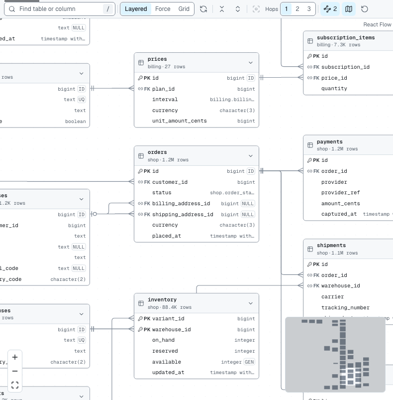
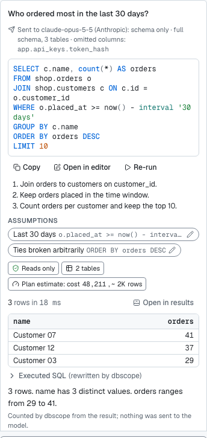
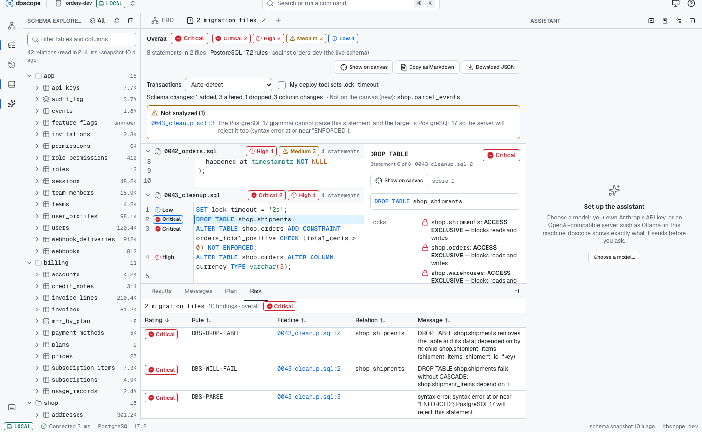

# dbscope

A local-first PostgreSQL workbench. One binary on your machine connects to your
databases and opens a web UI on `127.0.0.1` with three tools on one schema map:

- **Schema map** – an interactive ERD of a live database, with foreign keys it
  can infer when they were never declared.
- **Query tracing** – run SQL (or ask in plain English) and see the query plan
  drawn on the map: which tables are scanned, how, and which joins run.
- **Migration review** – drop in `.sql` migrations to see the locks they take,
  whether they rewrite tables, what depends on what they change, and safer
  alternatives. The same check runs in CI.

Everything runs locally. There is no dbscope server.



## Quick start

You need **Go 1.26+** (a newer toolchain downloads itself if needed) and **Node 22.12+**.

```bash
git clone <this repository> dbscope
cd dbscope
make build
./bin/dbscope ui
```

The browser opens on the onboarding page. Choose **Open sample schema** to look
around without a database, or paste a connection URL such as
`postgres://reader@localhost:5432/app?sslmode=prefer`.

On Windows without `make`, run the two build steps directly:

```powershell
npx -y pnpm@12.15.0 --dir web install --frozen-lockfile
npx -y pnpm@12.15.0 --dir web build
go build -o bin/dbscope.exe ./cmd/dbscope
```

`go install` alone is **not** enough: the UI is built by the web step and then
embedded, so a plain `go build` gives a binary that only serves its API.

## Connecting safely

dbscope only ever runs read-only work, but the safest setup is still a role that
can only read:

```sql
CREATE ROLE dbscope_reader LOGIN PASSWORD '...';
GRANT CONNECT ON DATABASE app TO dbscope_reader;
GRANT USAGE ON SCHEMA public TO dbscope_reader;
GRANT SELECT ON ALL TABLES IN SCHEMA public TO dbscope_reader;
```

**Test connection** reports whether the role can write, whether the server is a
replica, and other warnings. Tag each connection as `local`, `staging` or
`prod-replica`; prod-replica connections show a permanent red banner, use a
shorter statement timeout and ask before expensive queries.

Every query runs as exactly one `SELECT`, checked by PostgreSQL's own parser, in
a read-only transaction that is always rolled back, with a statement timeout
and a server-side cursor that bounds how many rows are read. Details:
[docs/QUERY-SAFETY.md](docs/QUERY-SAFETY.md).

## What leaves your machine

| What | Where it goes | When |
|---|---|---|
| Database passwords | an encrypted file (`age`) whose key is in your OS keychain; never sent anywhere | always |
| Schema (table and column names, types, keys, comments) | the AI provider you configure | only when you ask the assistant a question |
| Result rows | the AI provider | only if you set the connection's summary mode to **rows**; on prod-replica you confirm first |
| Anything | Anthropic, OpenAI or any other service | never by default: no telemetry, no update checks |

Columns whose names look secret (`password`, `token`, `api_key`, …) are left
out of what the assistant sees. With the default summary mode, the short
summary under each answer is counted by dbscope itself and nothing about the
result is sent.

## The assistant

Open the assistant panel (Cmd/Ctrl+I) and choose a provider in its settings:

- **Anthropic** – paste an API key (stored in the encrypted vault). Default model `claude-opus-5-5`.
- **OpenAI-compatible** – any `/v1` endpoint, including a local
  [Ollama](https://ollama.com) (`http://127.0.0.1:11434/v1/`), which needs no key.

Every answer shows the SQL before its result, the steps it took, editable
assumptions, what was sent and to which model. Generated SQL goes through the
same read-only checks as SQL you type.

Accuracy on the bundled evaluation set (`eval/nl`) with small local models, 2026-10-27:

| Model (Ollama, Apple M2, 8 GB) | Pagila, 32 questions | Messy schema, 20 questions | Median time |
|---|---|---|---|
| qwen2.5-coder:3b | 37.5% | 20% | 8 s |
| qwen2.5-coder:7b | 53.1% | not measured | 19 s |

Larger hosted models are expected to do much better; run `dbscope eval nl` with
your provider to measure.



## Migration review in CI

```bash
./bin/dbscope migrate check db/migrations --dsn "$STAGING_REPLICA_URL" --fail-on high
```

It exits with `1` when any statement is rated at or above `--fail-on`. Without
database access in CI, export sizes once and check against a schema dump:

```bash
./bin/dbscope stats export --dsn "$URL" > stats.json   # sizes and row estimates only, no row data
pg_dump --schema-only "$URL" > schema.sql
./bin/dbscope migrate check db/migrations --schema-dump schema.sql --stats stats.json --format github
```

Formats: `text`, `json`, `sarif` (GitHub code scanning) and `github` (inline
annotations on pull requests). Lock and rewrite rules are checked against real
PostgreSQL 14, 17 and 18 by the test suite. Migrations using PostgreSQL 18-only
syntax are reported as not analyzable, because the bundled parser uses the
PostgreSQL 17 grammar. Rules and scoring: [docs/MIGRATIONS.md](docs/MIGRATIONS.md).



## Platforms

macOS, Linux and Windows, on amd64 and arm64; the binary is built without cgo.
Database passwords use the macOS Keychain, Windows Credential Manager or the
Linux Secret Service. Where none exists (headless Linux, WSL, or
`DBSCOPE_SECRETS=file`), the vault asks for a passphrase instead.

## Development

```bash
make test        # Go vet + tests, web lint + typecheck + unit tests
make e2e         # Playwright browser tests
make dev         # UI with hot reload on :5173; run the agent with: dbscope ui --dev-origin http://localhost:5173
```

Database tests start PostgreSQL 14/17/18 containers with Docker, or use
`DBSCOPE_TEST_DSN`; without either they are skipped. Design documents live in
[docs/](docs/): [ARCHITECTURE](docs/ARCHITECTURE.md), [API](docs/API.md),
[QUERY-SAFETY](docs/QUERY-SAFETY.md), [NL](docs/NL.md), [MIGRATIONS](docs/MIGRATIONS.md).
